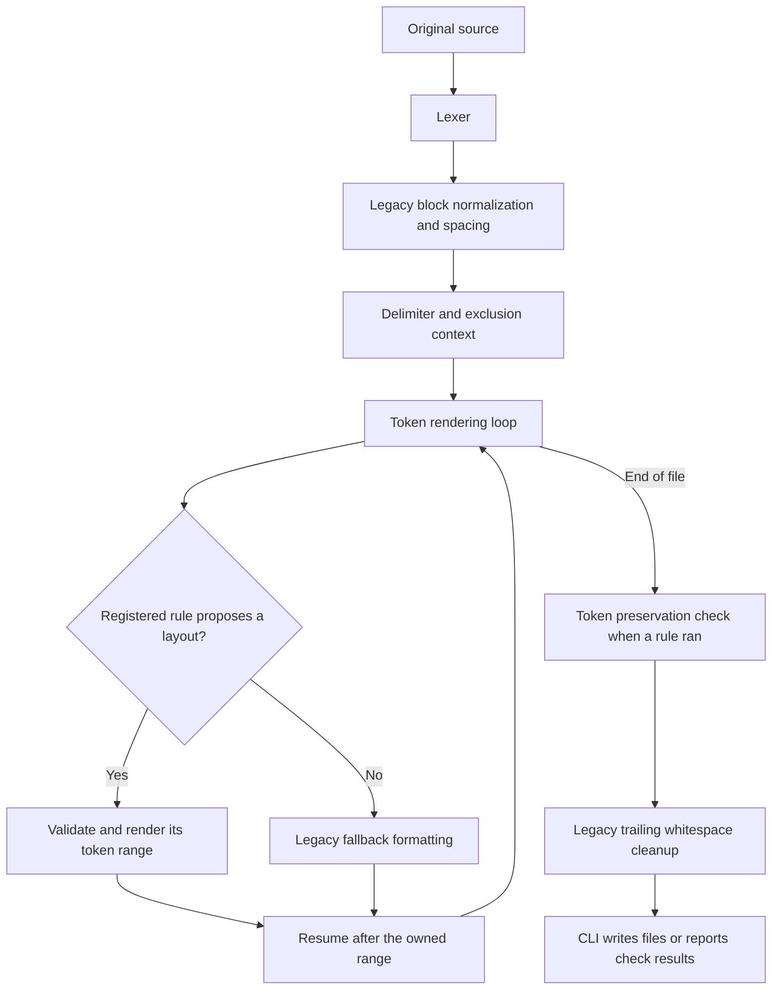
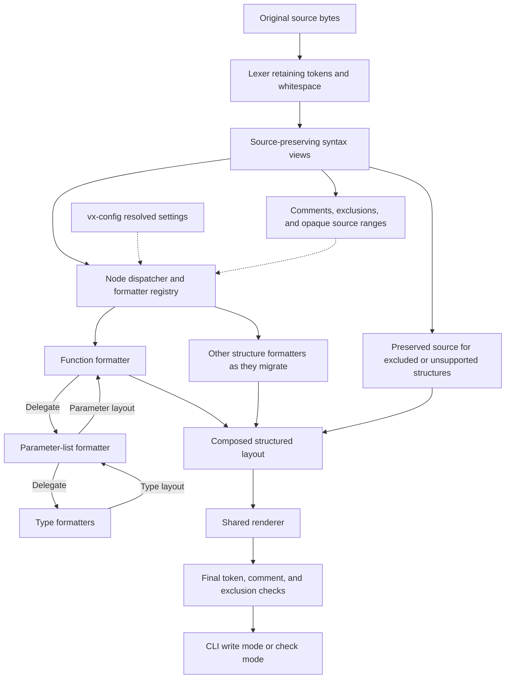
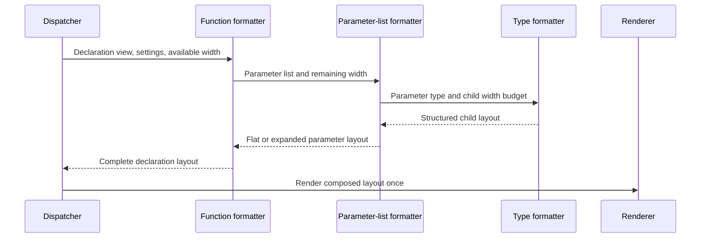

# Proposal: syntax-aware architecture for vx-format

Status: proposed for review. Implementation is not authorized by this document.

Prepared on 2026-10-29 for [issue 2343](https://github.com/vx-lang/Vx/issues/2343).

## Decision to review

Keep the configuration library, structured layout output, renderer, and preservation checks.
Change formatter dispatch from token positions to explicit source-syntax structures.
Let parent formatters delegate nested structures to child formatters with a shared width budget.

Start with a function-declaration view over the original source.
Keep a path toward a complete syntax tree without requiring that investment immediately.
Do not add more independent declaration scanners before reviewing this boundary.

This proposal changes the internal architecture.
It does not propose new formatting styles, configuration keys, lint rules, or external plugins.
Existing formatting behavior should remain stable during the first migration steps.

## Current implementation

The formatter currently tokenizes source, applies legacy normalization and spacing passes, then renders tokens.
The rendering loop consults registered rules at eligible token positions.
Function-signature formatting is the first registered rule.
Whole-file exclusions and unknown lexer tokens can return the source unchanged before the later passes.



Current responsibilities are documented in [the rule contributor guide](../tools/vx-format-rules.md).
The relevant implementation files are:

| File | Current responsibility |
| --- | --- |
| `src/formatter.rs` | Legacy passes, token traversal, rule invocation, and fallback rendering. |
| `src/formatter/context.rs` | Shared delimiter matching, exclusions, settings, and current output position. |
| `src/formatter/registry.rs` | Rule registration, eligibility, names, and execution order. |
| `src/formatter/layout.rs` | Token-and-whitespace instructions and replacement validation. |
| `src/formatter/renderer.rs` | Rule-output rendering and lexical token validation. |
| `src/formatter/rules/function_signatures.rs` | Recognizing declarations and choosing their layout. |
| `vx-config/src/lib.rs` | Formatter configuration discovery, parsing, defaults, and overrides. |

The current design establishes useful boundaries.
Rules have no direct file access or mutable output buffer.
Duplicate names and competing proposals cause assertions.
The plan checks token order and complete delimiter pairs.
The renderer checks for accidental lexical token merging.

However, one accepted replacement owns its entire range.
Other rules do not run independently inside that range.
The signature rule must recognize declarations and format their internal spacing itself.

The token check currently precedes legacy trailing-whitespace cleanup.
It does not establish preservation of the final output after that cleanup.
Exclusion protection in the rule framework also does not cover every earlier legacy transformation.
The target architecture should apply preservation guarantees across the complete pipeline.

Existing tests compile, but their execution and mutation checks remain pending at the user's request.
The current framework must not be treated as fully validated.

## Why the current model becomes expensive

### Repeated recognition of language syntax

A token sequence identifies punctuation and words without identifying their grammatical roles.
Matching parentheses cannot distinguish function parameters, call arguments, tuple types, and grouped expressions by itself.

Each substantial rule would need more surrounding context.
Separate scanners could disagree about generic arguments, comments, attributes, or new language constructs.
Over time, these scanners would form an informal parser distributed across rule modules.

Central syntax recognition gives formatters one interpretation of the source.

### Nested layout does not fit independent range ownership

A function formatter owns a signature containing parameter types.
A future type formatter might need to wrap a generic or tuple type inside that signature.
The current traversal skips that inner range after accepting the function rule.

Calling the type formatter first does not solve the general problem.
The function formatter still needs to choose a complete layout using the child's resulting width.
Running repeated passes could require several invocations to reach stable output.

The target design should compose nested layouts during one formatting operation.

### Width decisions need shared context

Consider this declaration:

```vx
fn combine(first: Tensor<f32, [64, 64]>, second: Tensor<f32, [64, 64]>) -> i32;
```

The parameter formatter needs less space than the whole declaration.
Indentation, the function name, separators, and the return type consume part of the available width.

Independent rules can count the same space differently.
A parent should assign space to each child and select a complete layout from the results.

### Comments require ownership

The current signature rule declines declarations containing comments.
That conservative policy prevents some unsafe rewrites, but limits useful formatting.

Broader support needs answers to these questions:

- Does a comment belong before a parameter or after the previous parameter?
- Does an end-of-line comment require the following token to stay on another line?
- Does a comment describe a list, its closing delimiter, or one element?
- Which original bytes must remain untouched inside an excluded region?

These decisions should live in shared syntax and comment services.
Every rule should not rediscover them.

### Conflict detection does not define composition

An overlap assertion identifies an implementation conflict.
It cannot decide which formatter owns a nested construct or how two layout decisions should combine.

Explicit parent-child relationships provide that ownership.
Registration should select the formatter for a structure, rather than let several scanners compete for the same text.

## What Rustfmt provides as a reference

Rustfmt uses the Rust compiler's syntax tree before macro expansion.
A visitor handles top-level traversal and delegates to structure-specific rewrite implementations.
Those implementations can format their children recursively.
Source spans recover text and comments that the syntax tree does not retain directly.
See the [Rustfmt architecture guide](https://github.com/rust-lang/rustfmt/blob/main/Contributing.md#a-quick-tour-of-rustfmt).

Its `Rewrite` interface receives shared context and a `Shape`, then returns formatted text or a formatting failure.
The context includes configuration and source access.
`Shape` tracks width, indentation, and offset.
See [rewrite.rs](https://github.com/rust-lang/rustfmt/blob/main/src/rewrite.rs) and
[shape.rs](https://github.com/rust-lang/rustfmt/blob/main/src/shape.rs).

The useful architectural lesson is recursive formatting with explicit space budgets.
Our registry and structured layout instructions are Vx design choices.
They are not copies of a Rustfmt plugin registry or its string-returning rewrite interface.

Rustfmt also checks expected output and repeated-formatting stability.
Those validation practices matter independently of the representation we choose.
See [its testing guide](https://github.com/rust-lang/rustfmt/blob/main/Contributing.md#create-test-cases).

## Options

| Option | Benefit | Cost or limitation |
| --- | --- | --- |
| Keep token-position rules | Lowest immediate migration cost; useful for simple local whitespace rules. | Grammar recognition and nested layout remain distributed across rules. |
| Use the compiler's current transformed AST | Reuses recognized declarations and types. | Source distinctions and comments are incomplete; current parsing already rewrites some syntax. |
| Build source-preserving syntax views incrementally | Establishes ownership early and preserves existing layout infrastructure. | Requires shared recognition code and explicit opaque-node behavior. |
| Build a complete concrete syntax tree immediately | Gives every token and comment a structural home from the start. | Largest initial scope and parser-maintenance commitment. |

Recommended: incremental source-preserving syntax views, with recursive formatter dispatch.
The views should evolve into a coherent syntax representation rather than unrelated rule-specific parsers.

## Proposed architecture



The diagram describes the target, not the current implementation.
Function calls remain outside the first migration scope.
No type checking, import loading, macro expansion, or backend compilation is required for formatting.

The current formatter still builds within `vxc` and inherits its build dependencies.
This proposal does not claim that the formatter is already independent of LLVM or MLIR.
Extracting a standalone formatting crate can remain a separate packaging task.

### Original source is authoritative

Build syntax views from the original source before whitespace normalization.
Every token and source range should refer to that immutable source snapshot.
Do not identify syntax after rewriting text and then treat the old positions as authoritative.

Preserve spaces, line endings, comments, and original punctuation as source data.
Whitespace and comments outside the main grammatical structure are often called trivia.
A lossless representation retains that data even when a formatter chooses a different layout.

Reconstructing an untouched syntax view must reproduce its original bytes exactly.
This requirement includes excluded regions and opaque structures.

### Initial syntax views

The following names describe proposed interfaces, not existing APIs:

| View | Information exposed |
| --- | --- |
| `SourceFileView` | Original source, tokens, line information, and top-level structures. |
| `FunctionDeclView` | Modifiers, name, generic parameters, parameter list, return type, and declaration boundaries. |
| `ParameterListView` | Delimiters, ordered parameters, separators, and associated comments. |
| `ParameterView` | Name, type, source range, and associated comments. |
| `TypeView` | Structured supported types or an opaque range preserving the original text. |
| `OpaqueView` | A confidently bounded structure that remains unchanged. |

The first version can leave complex types opaque.
It should still distinguish top-level parameter separators from commas inside those types.
Extend shared views when adding support for another construct.
Do not add a new recognizer inside each formatting rule.

Reuse the existing lexer.
Evaluate reusable parser helpers before writing recognition code.
Do not make formatter recognition depend on semantic analysis or checked compiler modules.

In particular, the current parser converts a final expression into a return statement.
See `src/parser/decl.rs`.
Using that transformed representation alone would lose a source distinction the formatter may need.
A future shared parser interface must retain original syntax or provide a separate source-syntax result.

### Dispatch by syntax kind

Retain a registry as an extension point, but change what it selects.
The registry should identify one owning formatter for a syntax kind.
Duplicate ownership should be an explicit construction error.

The dispatcher should not ask every formatting rule to scan every token position.
A function formatter receives a recognized declaration.
A type formatter receives a recognized type or an opaque source range.

Alternative styles belong inside the owning formatter and its typed settings.
Registration order should not determine which competing interpretation of a structure wins.
External detector expressions and dynamically loaded plugins remain deferred.

### Parent-child composition and width budgets

Introduce a shared shape or width-budget object.
It should describe the current column, enclosing indentation, and available space.
The owning formatter reserves space for surrounding syntax before calling a child.



The function formatter keeps a flat declaration when it fits.
Otherwise, it requests or selects the multiline parameter layout.
Parameter and type formatters return nested layout instructions rather than editing the source separately.

The existing `fn_signature_width` remains the declaration's preferred width.
This migration does not introduce a global width setting or rename existing configuration.
Unbreakable names and types can still exceed a preferred limit.

Start with explicit flat and expanded alternatives.
A general constraint solver or optimization system is not required for this proposal.
The renderer should not rerun formatting rules until output happens to stabilize.

### Retain and extend the layout model

Keep the distinction between layout decisions and output generation.
Extend the current flat token-and-whitespace instructions to support nested layout composition.
Add a source-range preservation operation for opaque or excluded text.

That operation references original source bytes.
It does not permit arbitrary replacement code.
Parent and child layouts should flatten into one validated output plan.

Each token, comment, and retained source range must have one owner.
Source tokens must not be duplicated, removed, reordered, or merged by a whitespace decision.
Do not add trailing parameter commas: the current Vx grammar does not accept them.

### Comments and formatting exclusions

Preserve comment order and text unless a separate comment-formatting feature explicitly permits changes.
Represent comments before a node, after a node, and between list elements.
Keep the required newline after an end-of-line comment.
When ownership is uncertain, preserve the containing structure instead of guessing.

Compute exclusions from original source before any rewriting pass.
An exclusion overrides normal formatting decisions in every pipeline stage.
Preserve excluded bytes exactly, including their whitespace.
Final cleanup must not modify excluded regions or string contents.

Broader comment reflow, line-ending normalization, and new exclusion syntax require separate behavior decisions.
The architecture should preserve the information those features would need.

### Unsupported and invalid source

A syntax-aware formatter must distinguish an unsupported structure from a successfully formatted structure.
Preserve a bounded unsupported structure as opaque source.
If reliable boundaries are unavailable, preserve the entire file.
Never guess a range that might consume another declaration or comment.

Introduce an internal outcome that records complete formatting, preserved unsupported syntax, or invalid syntax.
The existing string-only result cannot express all three cases.

The CLI policy needs a separate review decision.
One recommendation is that strict check mode must not report complete success when parsing coverage is incomplete.
That policy would change observable behavior and must not enter the initial behavior-preserving refactor silently.

## How adding a rule would work

For a new array-layout rule:

1. Add or extend a shared array syntax view.
1. Implement the array formatter against that view.
1. Delegate element formatting to the owning child formatters.
1. Register ownership of the array syntax kind.
1. Add typed settings only for implemented choices.
1. Add expected-output, preservation, nesting, comment, and stability cases.

The new formatter should not modify the CLI, write files, or rescan arbitrary surrounding tokens.
If the array occurs inside another structure, its parent invokes it explicitly.

The same principle applies to function calls when their formatting enters scope later.

## Migration plan and gates

| Step | Scope | Completion evidence |
| --- | --- | --- |
| 0. Establish a baseline | Run existing configuration, formatter, CLI, and framework tests when authorized. | Record actual results and required mutation checks; keep existing failures distinct. |
| 1. Introduce source views | Recognize function declarations from original source without changing output. | Views reconstruct original bytes and identify nested parameter boundaries correctly. |
| 2. Add hierarchical dispatch | Select the function formatter by syntax kind and carry explicit width budgets. | Existing signature outputs and CLI behavior remain unchanged. |
| 3. Compose child layouts | Delegate parameter lists and supported types; preserve unsupported types as opaque ranges. | Nested-layout fixtures stabilize in one formatting invocation. |
| 4. Migrate legacy passes | Move block and spacing policies under structure ownership in small changes. | Each migrated policy passes preservation, exclusion, and output checks. |
| 5. Consolidate | Remove superseded token-position dispatch and scanners. | One ownership model remains; no supported structure is formatted twice. |

Do not replace the entire formatter in one change.
Do not format the repository merely to demonstrate the migration.
Keep behavioral improvements separate from architectural migration where practical.

During the transition, partition source ownership explicitly.
A supported syntax span belongs to its new formatter.
A legacy fallback may format an independently owned region, but must not rewrite a span already handled by the new path.
Protected and opaque regions retain their original bytes through both paths.

## Validation requirements

Required checks include:

- Paired source and expected-output fixtures for supported declarations and nested constructs.
- Short signatures remaining flat, including exact width boundaries and indentation effects.
- Long signatures expanding without splitting commas inside nested types.
- Expected behavior for comments before, between, and after parameters.
- Exact excluded-byte preservation through all passes and final cleanup.
- Original token order and spelling, including lexical boundaries and string contents.
- Stable output after one formatting invocation.
- Equivalent layout in write mode and non-writing check mode.
- Configuration defaults, overrides, and printed defaults remaining compatible.
- Unicode source positions, line endings, and opaque syntax where supported.
- Explicit handling of malformed delimiters and incomplete parsing coverage.

Reparse supported formatted fixtures to establish that formatting preserves valid source.
Mutation-check the important assertions individually, as repository guidance requires.
Test execution remains deferred until the user lifts the existing no-tests instruction.

## Costs and remaining review decisions

The proposal adds a source-syntax layer and ownership rules that require maintenance.
Incremental views are smaller than a complete concrete syntax tree, but still need coordinated grammar updates.
Original tokens, syntax views, and layout data also consume memory.
Measure these costs before selecting more elaborate representations.

Review these decisions before implementation:

1. Is incremental source-preserving syntax recognition the preferred path over a complete syntax tree immediately?
1. Which existing parser helpers can be reused without source transformations or semantic analysis?
1. Should the initial type view remain opaque except for structural boundaries?
1. Is one owning formatter per syntax kind the intended extension model?
1. Which incomplete-formatting outcomes should fail normal mode or check mode?
1. Which existing comment and exclusion behaviors must change to meet exact preservation guarantees?

The recommendation is to approve the ownership and syntax boundaries first.
Choose the concrete parser integration after inspecting reusable frontend interfaces.
No compiler, formatter, configuration, or CI behavior changes are made by this proposal document.
