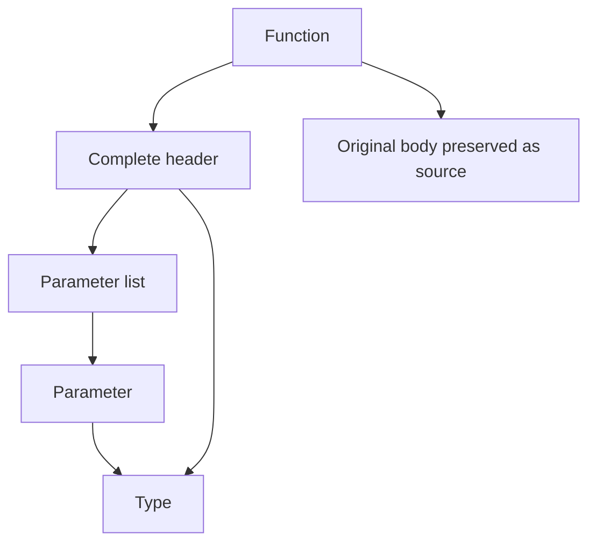

# Experimental source-syntax formatter foundations

The new foundations live in `src/formatter/source/`.
The existing CLI still uses the token-rule pipeline described in [the contributor guide](vx-format-rules.md).
There is no runtime flag selecting the experimental pipeline.
These Rust interfaces are experimental and carry no compatibility promise.

## Source recognition

`SourceFileView::parse` retains the original source snapshot, token byte ranges, and delimiter pairs.
It identifies macro envelopes before looking for functions in their contents.
Macro invocations include their trailing blocks.
Macro definitions retain matcher and transcriber token-tree ranges under one opaque envelope.
Formatter directives inside opaque macros cannot extend outside their envelopes.

Function-header recognition uses a separate reader in `src/parser/formatting.rs`.
It reuses the existing type, generic, topology, and expression parsing routines.
It does not parse or transform function bodies, load imports, check types, or expand macros.
The ordinary compiler parser entry points are unchanged.

The reader records parameter types, return types, and ordered `on`, `requires`, `ensures`, and `where` clauses.
Unknown header suffixes produce coverage warnings instead of partially recognized function views.
Uncertain delimiter or macro boundaries also produce preservation warnings.

Parser-recognized type ranges are token-backed views.
They do not yet expose a complete recursive type-syntax tree.
Header recognition is not a complete file grammar or a guarantee of contextual eligibility for every declaration form.
Foreign declarations, trait signatures, and method contexts still need their complete compatibility inventory before CLI activation.

## Dispatch and nested layout

`NodeRegistry` assigns one formatter to each `SyntaxKind` and rejects duplicate ownership.
`NodeContext::child` delegates nested formatting with an explicit `Shape`.
`Shape` carries the current column, indentation level, indentation width, and line-width budget.

The experimental built-in registry composes these owners:

`format_declaration` exercises that composition for one recognized declaration.
It formats the header and preserves the body.
It is not a replacement for full-file formatting.
Coverage in its result describes that requested formatting operation, not support for every construct in the file.

`Document` represents original tokens, spaces, line breaks, nested concatenation, width-limited children, flat/expanded alternatives, and exact source copies.
The renderer chooses alternatives against the current column and width budget.
Rules do not construct replacement source code strings.

## Preservation and isolation

`verify_preservation` and `verify_span_preservation` check token identity, spelling, grammatical gaps, and exact opaque or excluded bytes.
Sensitive angle-token and macro-name gaps initially retain their original adjacency conservatively.
These constraints do not classify generic closing brackets as shift operators.
Broader grammar-specific relaxation and full type-spacing parity remain migration work.

`OwnershipMap` distinguishes legacy, syntax-owned, excluded, opaque-macro, and unsupported source ranges.
Its legacy-edit guard rejects edits crossing protected ownership.
Protected children can exist inside a syntax-owned declaration.

`RenderedDocument` includes output segments with original-source provenance.
Opaque children must be supplied by complete preserved source segments.
Macro preservation also checks original columns so layout cannot silently reindent embedded languages.
Cleanup eligibility checks both legacy ownership and constrained source gaps.
The new renderer performs no global trailing-whitespace cleanup.

`RenderState` carries the enclosing delimiter stack, indentation, multiline-bracket flags, line, and column.
It can consume a preserved fragment without restarting state at zero.
Structural transitions occur once for the consumed original span.
Output positions come from the text actually rendered.

These guards are available for a future bounded legacy adapter.
The existing whole-stream normalization and cleanup functions are not yet connected to that adapter.
The isolation gate therefore remains incomplete.

## Coverage outcomes

`FormatOutcome` carries output, coverage, and warnings separately.
An unsupported experimental declaration falls back to its original bytes with a warning.
Warning-only `check_status` returns zero; actual output differences return one.
`CoverageWarning::render` produces a `WARN` message with a file and source line.
Argument, configuration, and file-access errors remain the command adapter's responsibility.

This does not yet enable general unknown-syntax detection or warning output in the existing CLI.
That integration must preserve the approved nonfatal policy.

## Activation gates

Before changing the CLI rendering path:

1. Execute the existing baseline and the new contract tests when authorized.
1. Complete the required mutation checks.
1. Establish full-header eligibility and type-spacing parity for supported declaration contexts.
1. Connect bounded legacy edits and provenance-aware cleanup without crossing opaque or excluded source.
1. Verify final adjacency, exact-byte preservation, state handoffs, and one-run formatting stability.
1. Integrate complete-file coverage and warnings without treating unsupported syntax as fatal.

The user requested no tests yet.
The new tests were added for compilation and later execution.
Do not infer successful behavioral validation from compilation alone.
