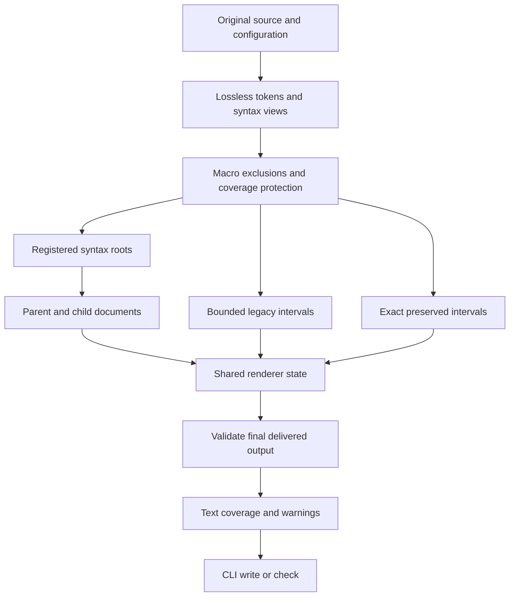

# Source-syntax formatter architecture

The CLI and library use the source-syntax pipeline in `src/formatter/source/`.
The former token-position registry and duplicate signature scanner were removed.
The Rust extension interfaces remain internal and can change.

## Source recognition

`SourceFileView` retains original bytes, token byte ranges, delimiter pairs, and grammatical gap constraints.
Byte ranges derive from cumulative token lengths, including whitespace and Unicode bytes.
Lexer line metadata does not define byte ownership.

Macro envelopes are discovered before ordinary function declarations.
Invocation arguments, trailing blocks, matchers, and transcribers remain opaque.
Directive-like comments and declaration-like text inside macros cannot escape their envelopes.
The engine preserves enclosing macro lines to retain embedded-language columns.

A separate reader in `src/parser/formatting.rs` reuses the compiler's existing grammar routines.
It records generics, parameters, return types, and ordered `on`, `requires`, `ensures`, and `where` clauses.
Body and remaining-file probes discard parsed structures after checking coverage.
These probes perform no import loading, type checking, macro expansion, or backend work.
Ordinary compiler parsing entry points remain unchanged.

Recognition records root, implementation, trait, and foreign declaration contexts.
Implementation and trait generics remain available to type recognition.
Unsupported contextual clauses preserve their declaration.
Unknown header boundaries preserve the file rather than accepting a partial header.
Arrowless headers remain accepted for compatibility with existing formatter and editor inputs.
This does not extend the compiler's accepted language.

Types remain parser-confirmed token-backed views rather than a complete recursive syntax tree.
Their formatter retains existing type whitespace normalization, including `Tensor<f32, [2, 2]>`.
Adjacent generic closing brackets can compact only within confirmed type ranges.
Expression shifts and macro-name adjacency retain grammatical constraints.

## Dispatch and composition

`NodeRegistry` assigns one formatter to each syntax kind.
Registered owners publish independent roots through `NodeFormatter::roots`.
Parents delegate children through `NodeContext::child` with an explicit `Shape`.
Child documents retain their shape and remaining width budget during later composition.
Parents select a group's expanded layout through the document interface rather than inspecting its representation.
No syntax-specific engine branch selects the current header rule.

The built-in root owner formats function headers.
It delegates parameter lists, parameters, and types.
Bodies retain existing formatting through the bounded legacy adapter.
The optional `format_declaration` helper composes a function document with an unchanged body.
It is not a second full-file pipeline.

`Document` supports original tokens, spaces, lines, concatenation, width reservations, layout alternatives, and exact source copies.
`Shape` supplies column, indentation, indentation width, and available width.
The renderer chooses flat or expanded layouts within the parent's budget.
Headers containing comments retain their original header text while supported surrounding code can still format.

## Ownership and state

Protection is installed before syntax dispatch and before legacy transformations.
Merged protected ranges cover macros, exclusions, and unsupported syntax.
The scheduler claims syntax roots outside those ranges.
Legacy normalization and spacing receive only the remaining bounded intervals.
`OwnershipMap::validate_legacy_edit` rejects transformations across protected or syntax-owned ranges.

One `RenderState` spans legacy, syntax, and preserved intervals.
It carries the delimiter stack, indentation, multiline-bracket flags, line, and column.
A preserved interval advances delimiter state from original tokens and position state from its unchanged bytes.
A syntax document reports its exit state.
The next legacy interval therefore retains enclosing braces and indentation.

Coverage probes omit excluded text while retaining delimiters connected to surrounding code.
An excluded opening block uses a neutral block in the grammar probe.
The original source and renderer still retain the real tokens and delimiter state.
Unsupported excluded statements therefore cannot disable independent supported declarations.

There is no whole-output whitespace cleanup.
Legacy whitespace cleanup operates on whitespace tokens inside permitted intervals.
String contents, comment contents, exclusions, and opaque text cannot be trimmed by that cleanup.
Exclusion marker lines now remain exact source, including their original indentation.
This deliberately corrects the old renderer's reindentation of those lines.

## Final preservation

The document renderer checks token order, complete source ownership, and preserved child provenance.
The full-file validator runs after every rendering operation.
It checks token kinds, spelling, grammatical adjacency, exact excluded or opaque bytes, and macro columns.
Any validation failure restores the original file and emits a warning.
Token equality alone cannot establish safety for shifts or embedded macro languages.

## Coverage and CLI behavior

`FormatOutcome` carries text, coverage, and warnings separately.
A coverage warning preserves the affected declaration when boundaries are certain.
Uncertain header, macro, delimiter, or file grammar boundaries preserve the complete file.
Other independent supported declarations can still format after a scoped warning.

The CLI prints `WARN` messages with file and line information.
Warning-only `--check` returns zero.
Supported formatting differences return one, even when other regions produce warnings.
Argument, configuration, and file-access errors return two.
Both write mode and check mode use the same validated result.

## Extension boundary

The infrastructure supports registered syntax owners without another scanner or renderer branch per rule.
New constructs still need shared recognition when no syntax view exists.
Unsupported constructs remain preserved until their coverage and layout are implemented.
Dynamic plugins, a stable public API, and a complete concrete syntax tree remain future choices.
See [the contributor guide](vx-format-rules.md) for the extension workflow.

## Indexed source traversal

Recognition builds one significant-token buffer and records scope context in one traversal.
Each declaration borrows that buffer instead of copying the remaining source tokens.
Byte intervals locate their token slices through binary searches.
Rendering, state updates, and local validation visit only those slices.
Local position maps use the interval's size rather than the complete file's size.
Ownership uses indexed syntax claims and sorted protected intervals.
The engine retains one final full-file preservation check after all output operations.
